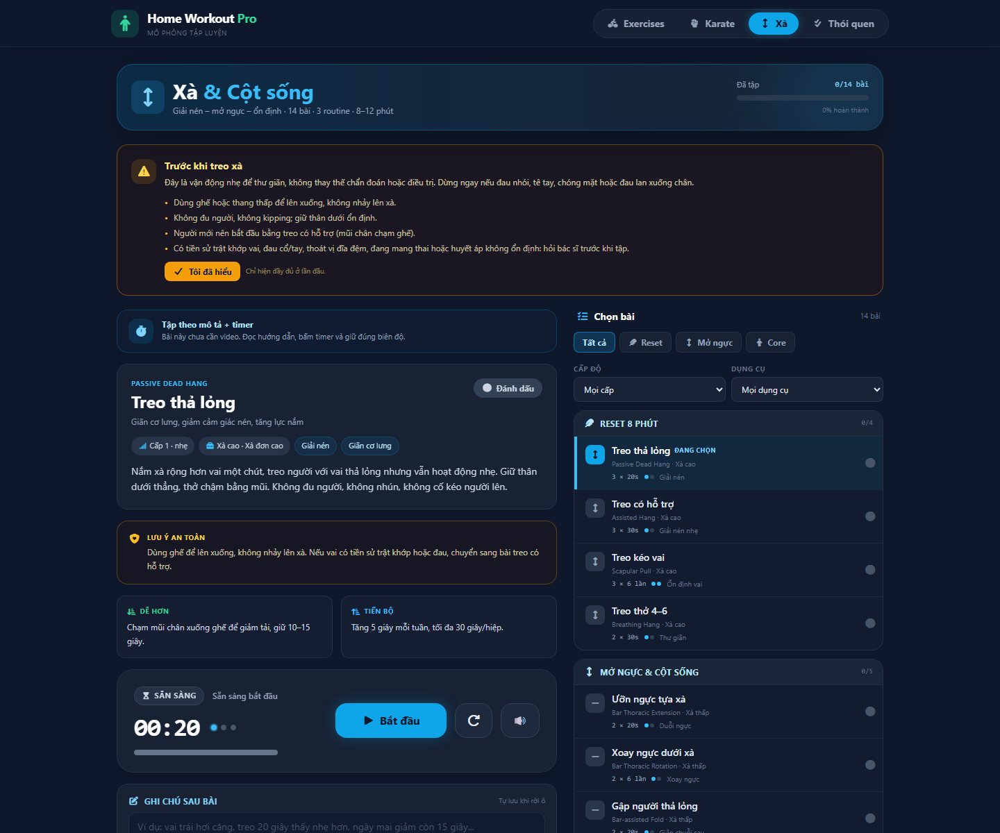
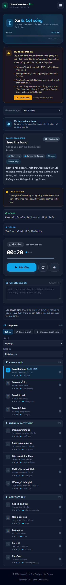
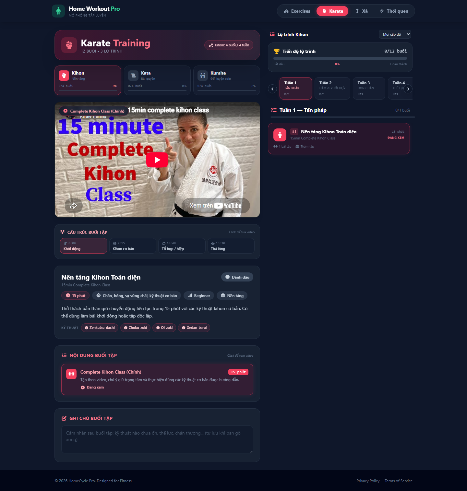

# Kế hoạch phát triển Home Workout Pro

> **Phiên bản:** 1.0 · **Ngày:** 24/10/2026  
> **Phạm vi:** mở rộng Karate, thêm mục riêng “Xà & Cột sống” cho dân văn phòng, tái cấu trúc nền để thêm chương trình mới nhanh.  
> **Giả định:** người dùng tập tại nhà, có xà đơn cao hoặc xà thấp; trình độ mới bắt đầu; 1 dev frontend; app chưa có backend.

---

## 1. Kết luận trước khi đi vào chi tiết

1. **Karate nên mở rộng theo “lộ trình” (track), không chỉ theo tuần.** Hiện 9 buổi đang xếp tuyến tính, trong khi người học có 3 nhu cầu khác nhau: Kihon (nền tảng), Kata (bài quyền), Kumite (đối luyện). Thêm track + timeline + thư viện kỹ thuật sẽ biến mục Karate từ “danh sách video” thành “chương trình học”.
2. **Mục Xà nên là route riêng `/xa`, không nhét vào trang Exercises.** Nó có đối tượng, thiết bị, nhịp tập và ngôn ngữ an toàn khác hẳn. Route riêng cho phép deep-link, lazy-load và theme riêng (sky thay vì emerald).
3. **Phải sửa 2 điểm nền trước khi thêm mục mới**, nếu không code sẽ rất giòn:
   - `useTimerStore` đang tự dò route bằng `window.location.pathname` để chọn session.
   - Các store đang lưu `selectedIndex`; thêm/xoá bài sẽ làm lệch lựa chọn đã lưu.
4. **Mục tiêu cuối cùng:** thêm một chương trình mới chỉ cần 1 file data + 1 store + 1 page, tái dùng timer/list/detail; không copy-paste logic.

---

## 2. Hiện trạng

### 2.1 Cấu trúc đang có

| Thành phần | Hiện tại | Ghi chú |
|---|---|---|
| Routes | `/`, `/karate`, `/habits` | `BrowserRouter`, lazy load từng trang |
| Exercise data | `src/data/exercises.js` | 20 bài, chia 4 tuần, gắn cứng `week` |
| Exercise store | `src/stores/useExerciseStore.js` | Lưu `selectedIndex`, `completedWeeks` |
| Karate data | `src/data/karateSessions.js` | 9 buổi, 5 tuần, 1 file 259 dòng |
| Karate store | `src/stores/useKarateStore.js` | Lưu `selectedIndex`, `completedIds`, `notes` |
| Timer | `src/hooks/useTimerStore.js` | Tự chọn session theo pathname |
| UI dùng lại | `ExerciseList`, `ExerciseItem`, `TimerControl` | Gắn màu emerald, nhãn tuần |
| CSS | Tailwind + `src/index.css` | Có `prefers-reduced-motion`, scrollbar theme |

### 2.2 Điểm nghẽn cần xử lý

| # | Vấn đề | Vị trí | Hệ quả khi thêm mục Xà |
|---|---|---|---|
| 1 | Timer dò route để lấy session | `src/hooks/useTimerStore.js:14-23` | Thêm `/xa` là timer không biết lấy bài nào; logic ngày càng rối |
| 2 | Chọn bài theo index | `HomePage.jsx`, `useExerciseStore.js` | Chèn bài mới làm lệch bài đang chọn sau khi reload |
| 3 | List gắn cứng nhãn tuần/màu xanh | `ExerciseList.jsx:69-72` | Không tái dùng được cho nhóm “Reset / Mở ngực / Core” |
| 4 | Karate data một cục, chưa có track | `karateSessions.js` | 9 buổi còn ổn; lên 20+ sẽ không lọc/lộ trình được |
| 5 | `WEEK_LABELS` chỉ có 5 tuần | `KarateSessionList.jsx:14-20` | Tuần 6+ sẽ trống nhãn |
| 6 | Chưa có search/filter | toàn app | 20 bài + 12 buổi còn chịu được; 30+ sẽ quá tải |
| 7 | Chưa có “buổi hôm nay”/gợi ý | — | Người dùng phải tự chọn, dễ bỏ tập |

---

## 3. Kiến trúc đích

### 3.1 Mô hình domain

```
Program (chương trình)
├── groups[]        Nhóm hiển thị: Tuần 1..4 / Reset / Mở ngực / Core
└── items[]         Bài tập hoặc buổi tập
    ├── timing      mode, duration, sets, reps, rest
    ├── content     name, guide, target, videoUrl
    └── metadata    level, equipment, spineFocus, deskIssues, track...
```

Với Karate, `items` là **session**, bên trong có thêm:

```
KarateSession
├── track           kihon | kata | kumite
├── week, order, level
├── techniques[]    id kỹ thuật → tra cứu thư viện
├── blocks[]        { label, start, end, kind } → timeline tua video
└── homework        bài tập về nhà ngắn
```

### 3.2 Routes

| Route | Trang | Theme | Ghi chú |
|---|---|---|---|
| `/` | Workout (4 tuần) | emerald | Giữ nguyên, đổi tên file `HomePage` → `WorkoutPage` |
| `/karate` | Karate | rose | Thêm track + timeline |
| `/xa` | Xà & Cột sống | sky | **Mới**, lazy load |
| `/habits` | Thói quen | amber | Không đổi |

### 3.3 Quyết định kỹ thuật (ADR ngắn)

| ID | Quyết định | Lý do |
|---|---|---|
| ADR-01 | Tách `/xa` thay vì tab trong `/` | Deep-link, bundle riêng, theme/an toàn riêng, không làm nặng trang chính |
| ADR-02 | Timer nhận session tường minh qua `loadSession(session)` | Bỏ phụ thuộc `window.location`; test được; thêm chương trình không sửa timer |
| ADR-03 | Lưu `selectedId` thay vì `selectedIndex` | Thêm/xoá bài không làm lệch lựa chọn; id là khoá ổn định |
| ADR-04 | Giữ JavaScript + JSDoc, chưa migrate TypeScript | Tránh big-bang refactor; JSDoc đủ cho schema bài tập |
| ADR-05 | Tái dùng `TimerControl`, không viết timer mới | Đã có xử lý tick/drift/sound/rest; chỉ cần thêm accent |
| ADR-06 | Không auto-unlock bài | Người dùng được tự do chọn; giảm frustration, tránh logic phức tạp |

---

## 4. Mở rộng Karate

### 4.1 Vì sao là track?

Người tập Karate tại nhà thường rơi vào 1 trong 3 mục tiêu:

- **Kihon:** muốn kỹ thuật cơ bản đúng, tấn pháp vững.
- **Kata:** muốn học bài quyền, nhớ chuỗi động tác.
- **Kumite:** muốn phản xạ, khoảng cách, phối hợp đòn.

Trộn cả ba vào một danh sách tuần làm người mới khó biết nên học gì. Tách track giúp trả lời câu hỏi “hôm nay tôi nên tập gì?”.

### 4.2 Ba track và phạm vi MVP

| Track | Mục tiêu | Đối tượng | MVP |
|---|---|---|---|
| Kihon | Tấn pháp, đấm, gạt, đá cơ bản | Người mới | 4 tuần × 1 buổi |
| Kata | Taikyoku, Heian 1–3 | Người mới → trung cấp | 4 tuần × 1 buổi |
| Kumite | Kamae, maai, phản xạ solo | Trung cấp | 4 tuần × 1 buổi |

MVP dùng lại 9 buổi hiện có, bổ sung 3 buổi để đủ 12. Các tuần 5–12 làm ở phase sau, không gộp vào MVP.

### 4.3 Lộ trình 12 tuần (mở rộng dần)

| Tuần | Kihon | Kata | Kumite |
|---|---|---|---|
| 1 | Tấn pháp, Choku-zuki | Taikyoku Shodan | Kamae, khoảng cách |
| 2 | Gyaku-zuki, Oi-zuki | Heian Shodan | Di chuyển, đấm nghịch tay |
| 3 | Age/Soto/Uchi-uke | Heian Nidan | Gạt – phản đòn |
| 4 | Gedan-barai, Mae-geri | Heian Sandan | Gohon kumite (solo drill) |
| 5–8 | Đòn phối hợp 1–3 | Heian Yondan, Godan | Kihon ippon (solo) |
| 9–12 | Tốc độ, lực, hơi thở | Bunkai cơ bản | Phản xạ có điều kiện |

> Ghi chú nội dung: không quảng cáo “thi đai”, không hướng dẫn đối luyện có đối thủ khi chưa có HLV. Các buổi Kumite solo chỉ gồm footwork, phản xạ với tưởng tượng, thao tác chậm.

### 4.4 Schema mở rộng

```js
// src/data/karate/sessions.kata.js
export const kataSessions = [
  {
    id: 'kata-heian-shodan',
    track: 'kata',
    week: 2,
    order: 1,
    level: 'beginner',            // beginner | intermediate | advanced
    name: 'Heian Shodan',
    subName: 'Bình an Sơ đoạn',
    duration: 900,
    durationDisplay: '15 phút',
    category: 'Kata',
    focus: ['Zenkutsu-dachi', 'Gyaku-zuki', 'Kime'],
    techniques: ['gedan-barai', 'oi-zuki', 'gyaku-zuki'],
    blocks: [
      { label: 'Khởi động & thở', start: 0, end: 120, kind: 'warmup' },
      { label: 'Học từng đoạn', start: 120, end: 720, kind: 'drill' },
      { label: 'Chạy liền bài', start: 720, end: 840, kind: 'practice' },
      { label: 'Thả lỏng', start: 840, end: 900, kind: 'cooldown' },
    ],
    guide: '...',
    homework: 'Tập chậm 3 lần, quay video tự đối chiếu.',
    videoUrl: 'https://www.youtube.com/watch?v=q1Rg8rUpjjw',
    source: 'Shotokan tutorial',
  },
];
```

Thư viện kỹ thuật:

```js
// src/data/karate/techniques.js
export const techniques = [
  {
    id: 'gyaku-zuki',
    name: 'Gyaku-zuki',
    vi: 'Đấm nghịch tay',
    track: 'kihon',
    cues: ['Xoay hông dứt khoát', 'Vai thả lỏng', 'Kime ở điểm kết thúc'],
    mistakes: ['Đẩy vai trước', 'Hông xoay chậm hơn tay', 'Khoá khuỷu quá mức'],
    videoUrl: '',
  },
];
```

### 4.5 UI/UX mới

1. **`KaratePathPicker`** — 3 tab track, hiển thị số buổi/tiến độ từng track. Mặc định chọn track của buổi đang xem.
2. **`KarateSessionTimeline`** — chia buổi thành các block; click block để tua video tới `start` tương ứng.
3. **`TechniqueChips`** — chip kỹ thuật dưới tiêu đề; click mở modal cues/lỗi thường gặp.
4. **`KarateProgress`** — tiến độ theo track + tổng; giữ progress tổng hiện có.
5. **Filter** — level, thời lượng (≤15/20 phút), dụng cụ; chỉ hiện khi track đã chọn.
6. **“Bài bổ trợ”** — cross-link sang bài thể lực (plank, squat) để buổi tập không chỉ có video.
7. **Nhật ký** — giữ `notes` hiện tại; thêm `lastPracticedAt` và số lần tập để gợi ý buổi tiếp theo.

### 4.6 Việc không nên làm ở phase này

- Không làm chấm điểm kỹ thuật bằng AI/video.
- Không làm đai/chứng chỉ.
- Không nhúng video quá dài (>25 phút) vì khó theo và nặng máy.
- Không thêm đối luyện có đối thủ thật khi chưa có hướng dẫn an toàn.

---

## 5. Mục “Xà & Cột sống”

### 5.1 Định vị

**Tên:** Xà & Cột sống  
**Tagline:** Giải nén – mở ngực – ổn định, 8–12 phút cho dân văn phòng.  
**Đối tượng:** người làm việc 6–8 giờ/ngày trước máy tính (dân văn phòng, người làm nghiên cứu/việc trí óc), cổ vai gáy cứng, ngực bị kéo về trước, lưng dưới mỏi; có xà đơn tại nhà hoặc xà thấp/khung cửa.  
**Tính chất:** vận động nhẹ, biên độ thoải mái, không tập đến mệt, không phải điều trị y khoa.

### 5.2 Nguyên tắc an toàn (bắt buộc hiển thị trước buổi đầu)

- Đây là vận động hỗ trợ thư giãn, **không thay thế chẩn đoán/điều trị**.
- Dừng ngay nếu đau nhói, tê tay, chóng mặt, hoa mắt, hoặc đau lan xuống chân.
- Không nhảy lên xà; dùng ghế/thang thấp để lên xuống.
- Không đu người/kipping; giữ thân dưới ổn định.
- Nếu có tiền sử trật khớp vai, đau cổ/tay, thoát vị đĩa đệm, đang mang thai hoặc huyết áp không ổn định: hỏi bác sĩ trước khi treo.
- Người mới nên bắt đầu với **treo có hỗ trợ** (mũi chân chạm ghế), không treo thả lỏng hoàn toàn.

> Nội dung an toàn nên được người có chuyên môn (HLV/bác sĩ) rà soát trước khi phát hành.

### 5.3 Format một buổi 8–12 phút

| Phần | Thời lượng | Nội dung |
|---|---|---|
| Khởi động | 2 phút | Cat-cow, xoay vai, xoay cổ tay, thở chậm |
| Bài chính | 6–8 phút | 3 bài × 2–3 hiệp, nghỉ 30–45 giây |
| Kết | 1–2 phút | Treo thả lỏng hoặc thở 4–6, ghi cảm nhận |

**Liều khuyến nghị:**

- Cường độ cảm nhận RPE 3–5/10; không bao giờ tập đến thất bại.
- Giữ 15–30 giây/hiệp; 2–3 hiệp; nghỉ 30–45 giây.
- 3–4 buổi/tuần, không tập treo nặng 2 ngày liên tiếp.
- Tăng tiến theo thời gian (+5 giây/tuần) trước khi tăng độ khó.
- Luôn giữ biên độ không đau; có thể co chân, chạm ghế, hoặc giảm thời gian.

### 5.4 Danh mục bài tập MVP

| Nhóm | Bài | Liều | Dụng cụ | Tác động chính | Cấp |
|---|---|---|---|---|---|
| Reset | Treo thả lỏng (Passive Hang) | 3 × 20s, nghỉ 40s | Xà cao | Giãn cơ lưng, cảm giác giải nén | 1 |
| Reset | Treo có hỗ trợ (Assisted Hang) | 3 × 30s | Xà + ghế | Làm quen, giảm tải | 1 |
| Reset | Treo kéo vai (Scapular Pull) | 3 × 6 | Xà cao | Ổn định bả vai | 2 |
| Reset | Treo thở 4–6 | 2 × 30s | Xà/ghế | Thư giãn, nhịp thở | 1 |
| Mở ngực | Ưỡn ngực tựa xà (Bar Thoracic Extension) | 2 × 20–30s | Xà thấp/khung | Mở ngực, chống gù | 1 |
| Mở ngực | Xoay ngực dưới xà | 2 × 6/bên | Xà thấp | Linh hoạt cột sống ngực | 1 |
| Mở ngực | Gập người thả lỏng (Bar-assisted Fold) | 2 × 20s | Xà thấp | Giãn chuỗi sau | 1 |
| Mở ngực | Mở khớp vai với khăn/xà | 2 × 8 | Khăn/xà | Vai trước, ngực | 1 |
| Core | Kéo xà đảo tay (Inverted Row) | 2–3 × 6–10 | Xà thấp | Lưng giữa, vai sau | 2 |
| Core | Nâng gối treo (Hanging Knee Raise) | 2 × 6–8 | Xà cao | Core, gập hông | 2 |
| Core | Giữ gối co (Tuck Hold) | 2 × 10–15s | Xà cao | Core ổn định | 2 |
| Core | Dead Bug / Bird Dog | 2 × 6/bên | Thảm | Core an toàn | 1 |
| Desk | Ghế ưỡn ngực | 2 × 20s | Ghế | Cột sống ngực | 1 |
| Desk | Cat-cow | 2 × 8 | Thảm | Cột sống, thư giãn | 1 |

**Quy tắc chọn bài:** mỗi buổi chỉ nên có 1 bài “treo” + 1 bài “mở” + 1 bài “core/desk”. Không xếp 3 bài treo nặng liên tiếp.

### 5.5 Ba routine mặc định

| Routine | Thời lượng | Thành phần | Phù hợp |
|---|---|---|---|
| Reset 8 phút | 8 phút | Assisted hang → Thoracic extension → Cat-cow | Ngày làm việc mệt, người mới |
| Mở ngực & cột sống | 10 phút | Passive hang → Bar extension → Rotation → Dead bug | Cứng ngực, gù vai |
| Core treo nhẹ | 12 phút | Scapular pull → Inverted row → Knee raise → Tuck hold | Muốn ổn định thân trên |

### 5.6 Schema và seed data

```js
// src/data/programs/spineBar.js
export const spineBarProgram = {
  id: 'spine-bar',
  title: 'Xà & Cột sống',
  subtitle: 'Giải nén – mở ngực – ổn định, 8–12 phút cho dân văn phòng',
  accent: 'sky',
  groupBy: 'routine',
  groups: [
    { id: 'reset', label: 'Reset 8 phút', icon: 'fa-feather' },
    { id: 'open', label: 'Mở ngực', icon: 'fa-arrows-up-down' },
    { id: 'core', label: 'Core treo nhẹ', icon: 'fa-person' },
  ],
  items: [
    {
      id: 'hang-relax',
      groupId: 'reset',
      name: 'Treo thả lỏng',
      subName: 'Passive Dead Hang',
      level: 1,
      mode: 'time',
      duration: 20,
      sets: 3,
      reps: null,
      rest: 40,
      equipment: 'Xà đơn cao',
      bar: 'high',
      target: 'Giãn cơ lưng, giảm cảm giác nén, tăng lực nắm',
      spineFocus: ['Giải nén', 'Giãn cơ lưng'],
      deskIssues: ['Cứng lưng dưới', 'Gù vai'],
      guide:
        'Nắm xà rộng hơn vai, treo người với vai thả lỏng nhưng vẫn hoạt động nhẹ. ' +
        'Giữ thân dưới thẳng, thở chậm. Không đu người, không nhún.',
      safety:
        'Dùng ghế để lên xuống. Nếu vai có tiền sử trật khớp hoặc đau, chuyển sang treo có hỗ trợ.',
      regression: 'Chạm mũi chân xuống ghế để giảm tải, giữ 10–15 giây.',
      progression: 'Tăng 5 giây mỗi tuần, tối đa 30 giây/hiệp.',
      videoUrl: '',
    },
    {
      id: 'thoracic-extension',
      groupId: 'open',
      name: 'Ưỡn ngực tựa xà',
      subName: 'Bar Thoracic Extension',
      level: 1,
      mode: 'time',
      duration: 20,
      sets: 2,
      reps: null,
      rest: 30,
      equipment: 'Xà thấp/khung',
      bar: 'low',
      target: 'Mở ngực, duỗi cột sống ngực',
      spineFocus: ['Duỗi ngực', 'Chống gù'],
      deskIssues: ['Gù vai', 'Cứng ngực'],
      guide:
        'Đứng cách xà một bước, hai tay nắm xà ngang hông. Ngả người về trước, ' +
        'để ngực mở ra, giữ hông thẳng. Không ưỡn quá mức gây đau lưng dưới.',
      safety: 'Giữ biên độ thoải mái; nếu đau lưng dưới, giảm độ ngả và siết nhẹ bụng.',
      regression: 'Dùng khung cửa hoặc tường thay xà.',
      progression: 'Tăng thời gian giữ lên 30 giây, không tăng độ ngả quá nhanh.',
      videoUrl: '',
    },
    {
      id: 'scapular-pull',
      groupId: 'reset',
      name: 'Treo kéo vai',
      subName: 'Scapular Pull',
      level: 2,
      mode: 'reps',
      duration: 30,
      sets: 3,
      reps: 6,
      rest: 40,
      equipment: 'Xà đơn cao',
      bar: 'high',
      target: 'Ổn định bả vai, kiểm soát vai',
      spineFocus: ['Ổn định vai', 'Kiểm soát'],
      deskIssues: ['Gù vai', 'Mỏi vai'],
      guide:
        'Từ tư thế treo, giữ tay thẳng, kéo nhẹ hai bả vai xuống và về sau ' +
        'mà không gập khuỷu. Giữ 1–2 giây rồi thả về.',
      safety: 'Không giật người; nếu không cảm nhận được bả vai, quay lại treo có hỗ trợ.',
      regression: 'Đặt chân lên ghế để giảm trọng lượng.',
      progression: 'Tăng lên 8 lần/hiệp khi kiểm soát tốt.',
      videoUrl: '',
    },
  ],
};
```

### 5.7 UI/UX

1. **Header xanh sky** + tên “Xà & Cột sống”, phụ đề rõ đối tượng.
2. **`SafetyNotice`** — banner đỏ nhạt, luôn hiện; có nút “Tôi đã hiểu” lưu localStorage (chỉ 1 lần).
3. **Bộ chọn routine** — 3 nút lớn: Reset 8' / Mở ngực / Core nhẹ.
4. **Filter** — cấp độ (1–3), dụng cụ (xà cao / xà thấp / không xà), vấn đề (cổ vai / lưng dưới / gù ngực).
5. **Danh sách bài** — hiển thị liều, cấp, tag tác động; không dùng checkbox tuần.
6. **Chi tiết bài** — guide, safety, regression/progression, timer tái dùng; video optional.
7. **Ghi chú** — “Hôm nay cảm thấy thế nào?” lưu theo bài hoặc theo ngày.
8. **Buổi hôm nay** — nút “Tập 8 phút” chọn sẵn 3 bài; phase 2 tự chuyển bài (auto-flow).

### 5.8 Nội dung cần chuẩn bị

- 3–6 video ngắn (20–60 giây/bài) hoặc dùng text + timer trước.
- Ảnh minh hoạ tư thế (nếu chưa có video).
- Câu chữ an toàn + disclaimer được duyệt.
- 3 routine được kiểm tra bởi HLV/bác sĩ.

### 5.9 Cách đo hiệu quả

- Tỉ lệ mở `/xa` rồi bấm bắt đầu timer.
- Tỉ lệ hoàn thành buổi 8 phút.
- Quay lại trong 7 ngày.
- Ghi chú “dễ chịu hơn/cứng hơn” (không dùng để chẩn đoán).

---

## 6. Cấu trúc file đích

```
docs/
├── ke-hoach-phat-trien.md           [NEW]  tài liệu này
└── screens/
    ├── xa-desktop.png               [NEW]  ảnh mục Xà
    ├── xa-mobile.png                [NEW]  ảnh mobile
    └── karate-desktop.png           [NEW]  ảnh Karate 3 track

src/
├── App.jsx                          [EDIT] thêm route /xa + lazy import
├── main.jsx
├── index.css
│
├── data/
│   ├── programs/
│   │   ├── index.js                 [NEW]  registry + getProgram()
│   │   ├── homeWorkout.js           [NEW]  adapter: bọc exercises.js thành Program
│   │   └── spineBar.js              [NEW]  14 bài + 3 routine
│   ├── karate/
│   │   ├── index.js                 [NEW]  gộp + sort sessions + gắn blocks
│   │   ├── tracks.js                [NEW]  3 track + metadata từng buổi
│   │   ├── blocks.js                [NEW]  chia timeline 4 block
│   │   ├── sessions.kumite.js       [NEW]  3 buổi Kumite solo
│   │   └── techniques.js            [NEW]  thư viện 16 kỹ thuật
│   ├── exercises.js                 [KEEP] nguồn dữ liệu 20 bài
│   └── karateSessions.js            [KEEP] 9 buổi gốc, được gắn metadata
│
├── stores/
│   ├── createProgramStore.js        [NEW]  factory dùng chung cho /xa
│   ├── useExerciseStore.js          [EDIT] selectedId + migrate
│   ├── useSpineBarStore.js          [NEW]  persist riêng
│   ├── useKarateStore.js            [EDIT] selectedId, lastPracticedAt
│   └── useTimerStore.js             [MOVE] từ hooks/useTimerStore.js
│
├── components/
│   ├── exercises/
│   │   ├── ExerciseList.jsx         [EDIT] nhận currentId
│   │   └── ExerciseItem.jsx         [EDIT] chọn theo id
│   ├── spine/
│   │   ├── SafetyNotice.jsx         [NEW]  banner an toàn + lưu ack
│   │   ├── SpineFilters.jsx         [NEW]  routine / cấp / dụng cụ
│   │   ├── SpineExerciseList.jsx    [NEW]  danh sách nhóm + tick done
│   │   ├── SpineDetail.jsx          [NEW]  guide + safety + regression
│   │   └── SpineNote.jsx            [NEW]  ghi chú tự lưu
│   ├── karate/
│   │   ├── KaratePathPicker.jsx     [NEW]  3 track + tiến độ
│   │   ├── KarateSessionTimeline.jsx[NEW]  timeline tua video
│   │   ├── TechniqueChips.jsx       [NEW]  chip + modal kỹ thuật
│   │   ├── KarateSessionList.jsx    [EDIT] nhận sessions đã filter
│   │   └── KarateDetail.jsx         [EDIT] timeline + chips + ngày tập
│   ├── timer/
│   │   └── TimerControl.jsx         [EDIT] prop accent (emerald/sky/rose)
│   └── layout/
│       └── Header.jsx               [EDIT] nav /xa + theme sky
│
├── pages/
│   ├── HomePage.jsx                 [EDIT] selectedId + timer loadSession
│   ├── KaratePage.jsx               [EDIT] track/filter/level
│   └── SpineBarPage.jsx             [NEW]
│
└── hooks/
    └── useTimerStore.js             [KEEP] re-export deprecated
```

**Nguyên tắc:** file cũ giữ lại làm re-export trong 1–2 phase để không gãy import; sau khi ổn định mới xoá.

---

## 7. Roadmap triển khai

Ước lượng cho 1 dev, chưa gồm thời gian quay/sưu tầm video.

### Phase 0 — Nền tảng (2 ngày)

| Việc | Output | DoD |
|---|---|---|
| Tách data chương trình + registry | `data/programs/*` | `/` vẫn chạy y hệt |
| Đổi store sang `selectedId` + migrate | `createProgramStore.js` | Reload vẫn đúng bài; localStorage cũ đọc được |
| Timer nhận session tường minh | `useTimerStore.loadSession()` | Không còn `window.location`; timer chạy ở `/` và `/karate` |
| Tách list/item dùng chung | `ProgramGroupList`, `ProgramItem` | Trang chính không lỗi visual |
| Chạy lint/build | — | `npm run lint`, `npm run build` pass |

### Phase 1 — Xà & Cột sống MVP (3 ngày)

| Việc | Output | DoD |
|---|---|---|
| 14 bài + 3 routine | `spineBar.js` | Đủ nội dung, liều rõ ràng |
| Store + page + route | `useSpineBarStore`, `SpineBarPage` | `/xa` load trực tiếp được |
| Safety + filter + timer | components | Safety hiện trước khi tập; filter hoạt động |
| Nav + theme sky | `Header`, `index.css` | Mobile 360px không tràn |
| Persist | localStorage | Reload giữ lựa chọn, completed, note |

### Phase 2 — Karate nâng cấp (4 ngày)

| Việc | Output | DoD |
|---|---|---|
| Tách 3 track + 12 buổi MVP | `data/karate/*` | 3 track, 4 tuần mỗi track |
| Path picker + progress | components | Chuyển track mượt, tiến độ đúng |
| Timeline + tua video | `KarateSessionTimeline` | Click block → video đúng mốc |
| Thư viện kỹ thuật | `techniques.js` + modal | Chip mở được, có cues/lỗi |
| Filter level/duration | `KaratePage` | Kết hợp track không xung đột |
| Migrate store | `selectedId`, `lastPracticedAt` | Note cũ giữ nguyên |

### Phase 3 — Tìm kiếm & cá nhân hoá (2 ngày)

- Search theo tên/tiếng Nhật/tag.
- Filter theo thời lượng, dụng cụ, vấn đề văn phòng.
- “Buổi hôm nay” gợi ý 1 buổi dựa trên lần tập gần nhất.
- Dashboard nhỏ: phút tập tuần này, chuỗi ngày, bài hoàn thành.
- Export/import JSON cho toàn bộ store (tái dùng pattern `BackupMenu` của Habits).

### Phase 4 — Chất lượng & phát hành (2 ngày)

- PWA/offline shell (tuỳ chọn), cache asset.
- Test store/utils bằng Vitest.
- Audit a11y: focus, aria, contrast, reduced motion.
- Lighthouse mobile ≥ 90 (performance/accessibility).
- Rà soát nội dung an toàn + disclaimer.

**Tổng:** ~13 ngày dev + 2–3 ngày nội dung.

---

## 8. Code khung

### 8.1 Registry chương trình

```js
// src/data/programs/index.js
import { homeWorkoutProgram } from './homeWorkout';
import { spineBarProgram } from './spineBar';

export const programs = {
  [homeWorkoutProgram.id]: homeWorkoutProgram,
  [spineBarProgram.id]: spineBarProgram,
};

export const getProgram = (id) => programs[id] ?? null;
```

```js
// src/data/programs/homeWorkout.js
// Phase 0: adapter mỏng, giữ exercises.js làm nguồn để tránh rủi ro.
// Phase 3 mới chuyển hẳn dữ liệu vào đây và để exercises.js re-export.
import { exercises, weekLabels } from '../exercises';

export const homeWorkoutProgram = {
  id: 'home-workout',
  title: 'Home Workout',
  subtitle: 'Lộ trình 4 tuần toàn thân',
  accent: 'emerald',
  groupBy: 'week',
  groups: Object.entries(weekLabels).map(([id, label]) => ({
    id,
    label: `Tuần ${id}: ${label}`,
  })),
  items: exercises.map((ex) => ({ ...ex, groupId: String(ex.week) })),
};
```

### 8.2 Store factory

```js
// src/stores/createProgramStore.js
import { create } from 'zustand';
import { persist } from 'zustand/middleware';

export const createProgramStore = ({ name, program, version = 1 }) => {
  const firstId = program.items[0]?.id ?? null;

  return create(
    persist(
      (set, get) => ({
        program,
        selectedId: firstId,
        completedIds: [],
        notes: {},

        selectItem: (id) =>
          set((state) => ({
            selectedId: state.program.items.some((item) => item.id === id)
              ? id
              : state.selectedId,
          })),

        toggleComplete: (id) =>
          set((state) => ({
            completedIds: state.completedIds.includes(id)
              ? state.completedIds.filter((x) => x !== id)
              : [...state.completedIds, id],
          })),

        setNote: (id, text) =>
          set((state) => {
            const notes = { ...state.notes };
            if (text?.trim()) notes[id] = text;
            else delete notes[id];
            return { notes };
          }),

        getSelectedItem: () => {
          const { program: p, selectedId } = get();
          return p.items.find((item) => item.id === selectedId) ?? p.items[0] ?? null;
        },
      }),
      {
        name,
        version,
        partialize: (s) => ({
          selectedId: s.selectedId,
          completedIds: s.completedIds,
          notes: s.notes,
        }),
        // v0 (selectedIndex) → v1 (selectedId)
        migrate: (persisted, oldVersion) => {
          if (!persisted) return persisted;
          if (oldVersion === 0 && Number.isInteger(persisted.selectedIndex)) {
            persisted.selectedId =
              program.items[persisted.selectedIndex]?.id ?? firstId;
            delete persisted.selectedIndex;
          }
          return persisted;
        },
        merge: (persisted, current) => {
          const merged = { ...current, ...(persisted || {}) };
          if (!program.items.some((item) => item.id === merged.selectedId)) {
            merged.selectedId = firstId;
          }
          return merged;
        },
      }
    )
  );
};
```

```js
// src/stores/useSpineBarStore.js
import { createProgramStore } from './createProgramStore';
import { spineBarProgram } from '../data/programs/spineBar';

export const useSpineBarStore = createProgramStore({
  name: 'spine-bar-storage',
  program: spineBarProgram,
  version: 1,
});
```

### 8.3 Timer không còn dò route

```js
// src/stores/useTimerStore.js — phần thay đổi chính
export const useTimerStore = create((set, get) => ({
  session: null,
  // ...
  loadSession: (session) => {
    clearTimer();
    const config = getSessionConfig(session);
    set({
      session,
      ...config,
      phase: 'idle',
      currentSet: 1,
      timeLeft: config.workDuration,
      isRunning: false,
      isCompleted: false,
      endsAt: null,
    });
  },

  startTimer: () => {
    const { isRunning, phase, session } = get();
    if (isRunning || phase === 'completed' || !session) return;
    // ... giữ nguyên logic hiện tại, bỏ getActiveSession()
  },

  fullReset: () => {
    clearTimer();
    const config = getSessionConfig(get().session);
    // ...
  },
}));
```

Page gọi:

```jsx
const handleSelect = (id) => {
  selectItem(id);
  const item = program.items.find((x) => x.id === id);
  if (item) loadSession(item);
};
```

Với Karate, `loadSession(session)` gọi khi đổi buổi; không cần timer biết route.

### 8.4 Route + Header

```jsx
// src/App.jsx
const SpineBarPage = lazy(() => import('./pages/SpineBarPage'));

<Routes>
  <Route path="/" element={<WorkoutPage />} />
  <Route path="/karate" element={<KaratePage />} />
  <Route path="/xa" element={<SpineBarPage />} />
  <Route path="/habits" element={<HabitsPage />} />
  <Route path="*" element={<Navigate to="/" replace />} />
</Routes>
```

```js
// src/components/layout/Header.jsx
const NAV_ITEMS = [
  // ...
  { to: '/xa', icon: 'fa-arrows-up-down', label: 'Xà', color: 'sky' },
];

const COLOR_CLASSES = {
  // ...
  sky: {
    active: 'bg-sky-500 text-slate-900 shadow-[0_0_12px_rgba(14,165,233,0.35)]',
    hover: 'text-slate-400 hover:text-sky-400',
  },
};
```

> Ở màn `< lg`, menu dropdown hiện đủ nhãn; ở desktop có thể dùng nhãn ngắn “Xà” để 4 tab không tràn.

### 8.5 Page skeleton

```jsx
// src/pages/SpineBarPage.jsx
import { useEffect, useMemo } from 'react';
import { useShallow } from 'zustand/react/shallow';
import Header from '../components/layout/Header';
import Footer from '../components/layout/Footer';
import SafetyNotice from '../components/spine/SafetyNotice';
import ProgramGroupList from '../components/program/ProgramGroupList';
import TimerControl from '../components/timer/TimerControl';
import { useSpineBarStore } from '../stores/useSpineBarStore';
import { useTimerStore } from '../stores/useTimerStore';

export default function SpineBarPage() {
  const { program, selectedId, completedIds, selectItem } = useSpineBarStore(
    useShallow((s) => ({
      program: s.program,
      selectedId: s.selectedId,
      completedIds: s.completedIds,
      selectItem: s.selectItem,
    }))
  );

  const selected = useMemo(
    () => program.items.find((item) => item.id === selectedId) ?? null,
    [program, selectedId]
  );

  const { loadSession, ...timer } = useTimerStore(
    useShallow((s) => ({
      loadSession: s.loadSession,
      phase: s.phase,
      // ... các field timer cần
    }))
  );

  useEffect(() => {
    if (selected) loadSession(selected);
  }, [selected, loadSession]);

  return (
    <div className="min-h-screen flex flex-col bg-slate-900 text-slate-200">
      <Header />
      <main className="max-w-6xl w-full mx-auto p-4 md:p-6 flex-grow grid grid-cols-1 lg:grid-cols-12 gap-6">
        <section className="lg:col-span-7 flex flex-col gap-6">
          <SafetyNotice />
          {/* detail + TimerControl accent="sky" */}
        </section>
        <section className="lg:col-span-5">
          <ProgramGroupList
            program={program}
            selectedId={selectedId}
            completedIds={completedIds}
            onSelect={selectItem}
            accent="sky"
          />
        </section>
      </main>
      <Footer />
    </div>
  );
}
```

### 8.6 Tua video theo block

```js
// src/components/shared/getVideoEmbedUrl.js
export const getVideoEmbedUrl = (url, options = {}) => {
  const { start } = options;
  // ... sau khi có params:
  if (Number.isFinite(start) && start > 0) {
    params.set('start', String(Math.floor(start)));
  }
};
```

```jsx
// KarateSessionTimeline.jsx
const handleBlockClick = (block) => {
  setActiveBlock(block);
  setVideoStart(block.start);
};

const embedUrl = getVideoEmbedUrl(session.videoUrl, {
  start: videoStart,
  controls: true,
});
```

> Khi `start` đổi, đặt `key={embedUrl}` cho iframe để YouTube nạp lại đúng mốc.

---

## 9. QA & nghiệm thu

### 9.1 Checklist chung

- [ ] `npm run lint` và `npm run build` pass.
- [ ] `/`, `/karate`, `/xa`, `/habits` load trực tiếp (F5) không 404.
- [ ] Reload giữ đúng bài/buổi đang chọn.
- [ ] localStorage từ bản cũ vẫn đọc được, không mất `completed`/`notes`.
- [ ] Mobile 360px: không tràn ngang, timer bấm được.
- [ ] Keyboard: tab được qua list, nút bắt đầu, filter; focus visible.
- [ ] `prefers-reduced-motion` không làm mất chức năng.
- [ ] iframe video lỗi → có fallback “Mở YouTube”.
- [ ] Không có `console.error` khi chuyển route.

### 9.2 Riêng mục Xà

- [ ] Safety hiện trước khi bắt đầu lần đầu.
- [ ] Mỗi bài có regression + progression + safety.
- [ ] Filter dụng cụ không trả về bài không dùng được.
- [ ] Timer tính đúng 3 hiệp, nghỉ 40 giây.
- [ ] Không có bài nào yêu cầu nhảy lên xà.

### 9.3 Riêng Karate

- [ ] 3 track hiển thị đúng số buổi/tiến độ.
- [ ] Timeline tua đúng block.
- [ ] Kỹ thuật chip mở đúng modal.
- [ ] Note cũ không mất sau migrate.
- [ ] Track không có buổi nào → empty state rõ ràng.

---

## 10. Rủi ro & giảm thiểu

| Rủi ro | Mức | Giảm thiểu |
|---|---|---|
| Nội dung xà không đúng an toàn | Cao | Review bởi HLV/bác sĩ; disclaimer; regression rõ |
| Video YouTube bị chặn/không embed | Trung bình | Kiểm tra trước khi thêm; luôn có link “Mở YouTube” + text guide |
| Migration localStorage làm mất dữ liệu | Trung bình | `version` + `migrate`; test payload cũ; không đổi key nếu không cần |
| Phình scope Karate (36 buổi) | Cao | MVP 3 track × 4 tuần; mở rộng theo phase |
| Timer refactor gây regression | Trung bình | Làm Phase 0 riêng, test cả `/` và `/karate` trước khi thêm `/xa` |
| 4 tab nav tràn trên desktop | Thấp | Nhãn ngắn “Xà”; kiểm tra ở 1024px |
| Nội dung tiếng Nhật sai chính tả | Thấp | Dùng nguồn chuẩn; review trước khi publish |

---

## 11. Quyết định cần chốt

1. **“Xà” trong yêu cầu là xà đơn cao, xà thấp, hay cả hai?** Kế hoạch này giả định cả hai, có filter dụng cụ.
2. **Có cần video riêng cho từng bài xà ngay phase 1 không?** Đề xuất: chưa; dùng text + timer, bổ sung video sau.
3. **Karate có cần track Kumite không, hay chỉ Kihon + Kata?** Đề xuất: có, nhưng chỉ drill solo, không đối luyện.
4. **Có muốn giữ tiếng Anh trong `subName` không?** Đề xuất: giữ để tra cứu YouTube.
5. **Có cần PWA/offline ngay không?** Đề xuất: để phase 4.

---

## 12. Bước tiếp theo

Nếu duyệt kế hoạch, thứ tự làm đề xuất:

1. **Phase 0** — tách data, store theo `id`, timer tường minh.
2. **Phase 1** — dựng `/xa` với 14 bài + safety + timer.
3. **Phase 2** — Karate 3 track + timeline + thư viện kỹ thuật.

Sau Phase 1 có thể dùng thử với 5–10 người văn phòng để chỉnh liều và câu chữ trước khi mở rộng Karate.

---

## 13. Trạng thái triển khai (24/10/2026)

### Đã hoàn thành — Phase 0 + 1 + 2

- [x] Tách `data/programs/*`, registry, adapter cho Home Workout.
- [x] Đổi `useExerciseStore` / `useKarateStore` sang `selectedId` + migrate từ `selectedIndex`.
- [x] Timer chuyển sang `stores/useTimerStore.js`, nhận `loadSession(session)`, bỏ dò `window.location`.
- [x] Thêm `/xa` — Xà & Cột sống: 14 bài, 3 routine, filter cấp/dụng cụ, safety banner, timer, ghi chú, tick hoàn thành.
- [x] Thêm 3 buổi Kumite solo; Karate có 12 buổi, 3 track, path picker, timeline tua video, thư viện 16 kỹ thuật.
- [x] Header 4 tab, theme sky, route lazy-load.
- [x] Kiểm tra migration localStorage từ schema cũ.
- [x] `npm run lint` và `npm run build` pass (build cần quyền ngoài sandbox vì Vite spawn tiến trình con).
- [x] Kiểm tra mobile 390px: `scrollWidth == viewport`, không tràn ngang.

### Chưa làm — Phase 3 + 4

- [ ] Search/filter toàn app, dashboard “hôm nay”, export/import JSON.
- [ ] PWA/offline, Vitest, audit a11y/Lighthouse, rà soát nội dung an toàn với chuyên gia.

### Ảnh minh hoạ

**Xà & Cột sống — desktop**



**Xà & Cột sống — mobile 390px**



**Karate — 3 track + timeline**



### Ghi chú kỹ thuật khi triển khai

- `karateSessions.js` gốc vẫn giữ nguyên 9 buổi; metadata track/tuần/kỹ thuật được gắn ở `data/karate/tracks.js` để không phải sửa nội dung video.
- `sessions.kumite.js` chứa 3 buổi drill solo, không có video; timeline đóng vai trò checklist.
- `src/hooks/useTimerStore.js` chỉ còn re-export; code thật nằm ở `src/stores/useTimerStore.js`.
- localStorage keys giữ nguyên (`exercise-storage`, `karate-storage`), thêm key mới `spine-bar-storage`.

